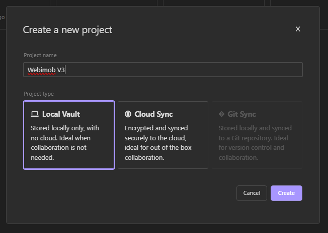
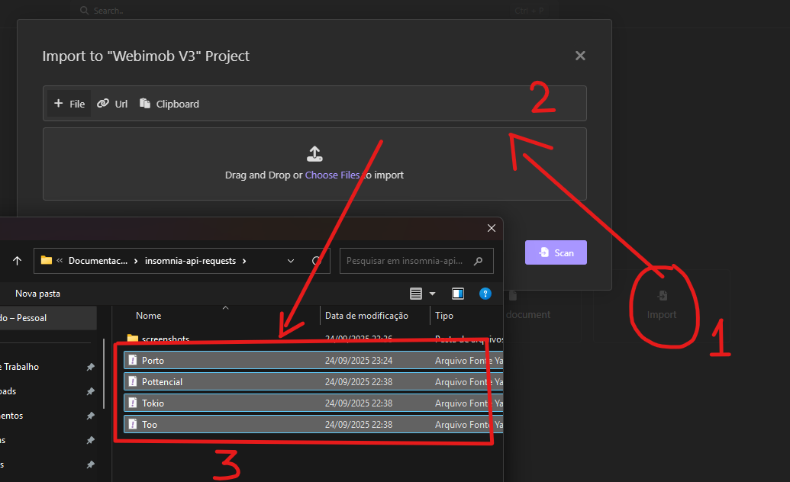
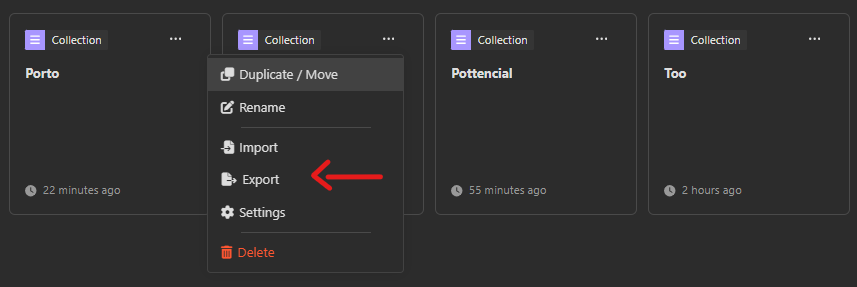

# 📚 Portal | Documentação Webimob

Este repositório centraliza toda a documentação da plataforma Webimob V3.

## 💻 Website das Docs

- Regras e Processos do Negócio
- Diagramas da Arquitetura do Sistema (implatanção, componentes e pacotes)
- DER (Diagrama de Entidades e Relacionamentos do Banco de Dados)
- Links de Portais + Contatos
- Sobre a Webimob (Stakeholders, Produtos, etc.)

[Acesse o Website da Documentação](https://docs.webimob.com.br)

--- 

## 🌐 Insomnia (Exemplos práticos de requisições para APIs externas)

O Insomnia é um *API Client*. Trata-se de uma ferramenta que simplifica o teste, a depuração e a interação com APIs. Ele permite enviar requisições HTTP a uma API e analisar as respostas recebidas de forma visual e intuitiva. Além disso, a ferramenta permite a configuração de **variáveis de ambiente** e suporta **diferentes protocolos (REST, GraphQL, etc.)**, tornando o processo de desenvolvimento e teste de aplicações que utilizam APIs mais eficiente. Utilizamos ele para testar integrações com:

- APIs de Seguradoras Parceiras (Porto, Tokio, Pottencial, Too)
- Outros serviços externos complementares (CPF.CNPJ, ViaCep, etc.)

Para colaborar é muito simples:

1. [Instale o Insomnia](https://insomnia.rest/download)
2. Crie um novo projeto usando a opção `Local Vault`

3. Importe as *collections* para dentro do projeto

4. A cada nova mudança em uma *collection*, basta exportar e sobreescrever o arquivo, e realizar o commit das mudanças!

*Infelizmente, a cada `git pull`, os arquivos terão que ser importados novamente. Isso acontece por que a feature `Git Sync` só é disponibilizada pelo Insomnia em planos pagos.*

---

## 👥 Contribuidores

| Nome | E-mail pessoal | Número |
| --- | --- | --- |
| Bernardo Cruz Rohlfs | berohlfs@gmail.com | (31) 9 9959-2002 |
| Eric Leal | ericgleal@gmail.com | (31) 9 3618-0182 |
| Gabriel Sathler | gabrielvdfs@gmail.com | (31) 9 7137-9793 |