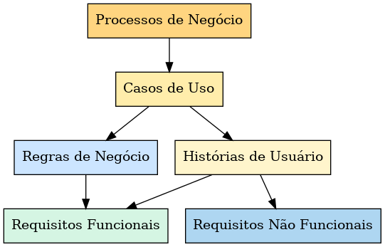

# 📚 Documentação Webimob V3

Este repositório centraliza toda a documentação da plataforma Webimob V3.

---

## 👥 Contribuidores

| Nome | E-mail pessoal | Número |
| --- | --- | --- |
| Bernardo Cruz Rohlfs | berohlfs@gmail.com | (31) 9 9959-2002 |
| Eric Leal | ericgleal@gmail.com | (31) 9 3618-0182 |

---

## 📂 Conteúdo da Documentação

### Documentação de Contexto

* Visão
* Produtos
* Stakeholders

### Documentação de processos

* Modelos de Processos de Negócio (BPMN)
* **Baixar** extensão no VS Code: *Camunda Modeler by Miragon - miragon-gmbh.vs-code-bpmn-modeler*

### Documentação de funcionalidades

* Casos de Uso
* Histórias de Usuário
* Regras de Negócio
* Requisitos Funcionais

### Documentação técnica

* Documentação de arquitetura (visão da distribuição lógica e física do sistema)
* Documentação de integrações com serviços externos

### Documentação de validação

* Documentação de casos de teste